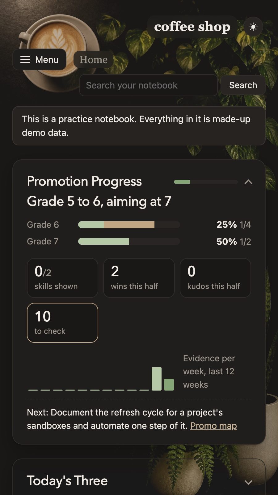

<h1 align="center">Coffee Shop</h1>

<p align="center"><em>Do the work. It remembers.</em></p>

<p align="center">
  
</p>

## What it does

- It gathers your days from Calendar, Tasks, Docs, Slack, and GitHub, twice each day.
- It sorts each record by its kind, and by the part of the leveling guide it shows.
- It counts a deed once, however many places it appears.
- It keeps the kind words others say of you, word for word.
- It holds your V2MOM, and notes which work moves each method forward.
- It shows how your year is going, one progress bar per KSO.
- It shows the path: what is shown, what is strong, what is still to come.
- Each morning it offers three small steps, none longer than ten minutes.
- When the season comes, it writes your promotion case, each sentence with its source, for you to shape and send to Google Docs.
- On Friday it tells you what the week added.
- It marks what Claude chose, so that you may decide.
- Each day it keeps a copy, and you may take everything with you.
- It lives on your machine. Only what Claude must read leaves it.

## Begin

First time? Follow [SETUP.md](SETUP.md): open this folder in Claude Code and type `/setup`. The same steps are on the setup page once the app is running: http://127.0.0.1:8765/setup. The commands below are the same thing by hand.

You need [uv](https://docs.astral.sh/uv/) and Claude Code signed in to the Google Workspace and Slack connectors. The same commands work on a Mac and on Windows.

```
cd ~/Documents/coffeeshop
uv run coffeeshop notebook init
uv run coffeeshop setup level
uv run coffeeshop schedule install
```

`setup level` asks for your role and your grade now, and loads that role's leveling guide. Then open http://127.0.0.1:8765 in a browser. On a Mac you can run `open http://127.0.0.1:8765`.

Records are sorted against the leveling guide from `setup level`. A V2MOM is optional. It adds your methods to that sort ([INSTRUCTIONS.md](docs/INSTRUCTIONS.md)).

To try it with made-up data: `uv run coffeeshop demo seed --data-dir /tmp/cos-demo && uv run coffeeshop serve --data-dir /tmp/cos-demo`. The screenshot above is that practice notebook.

## Read more

- [INSTRUCTIONS.md](docs/INSTRUCTIONS.md): every page, button, and command.
- [TECHNICAL.md](docs/TECHNICAL.md): how it is built, for people reviewing the code.
