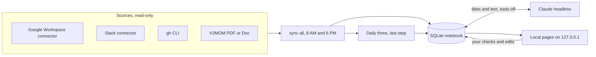

# Career Tracker: technical notes

For people reviewing the code. The user guide is [INSTRUCTIONS.md](INSTRUCTIONS.md).

- [Stack and layout](#stack-and-layout)
- [Data flow](#data-flow)
- [Where data lives](#where-data-lives)
- [Security](#security)
- [What goes to Claude](#what-goes-to-claude)
- [Schedules](#schedules)
- [Database and migrations](#database-and-migrations)
- [Tests](#tests)
- [Reviewing a PR](#reviewing-a-pr)

## Stack and layout

Python 3.12, FastAPI, SQLAlchemy on SQLite, Jinja2, Typer, uv. No JavaScript framework; a few small scripts in `web/static/`.

| Path under `src/careeros/` | What it does |
|---|---|
| `cli.py` | Every `careeros …` command; thin glue over the modules below |
| `web/` | The pages (`app.py`), background jobs with progress (`jobs.py`, `syncs.py`), templates, static files |
| `google/` | Calendar, Tasks, Docs, and meeting-note summaries through Claude Code's Google Workspace connector |
| `slack/` | The activity-tracker canvas, its sorting and import, and kudos from public channels |
| `github/` | Merged PRs and weekly review counts through the `gh` CLI |
| `v2mom/` | Reading the V2MOM (PDF or Google Doc), stable method ids, links from work, per-method report |
| `guide/` | The leveling guide, links to it, grouping records into work, the Promo map, Claude's read-through |
| `promo/` | The promotion-case writer and its per-sentence checks |
| `daily.py` | Today's three: context, one Claude ask, strict validation, check and uncheck |
| `digest.py`, `dashboard.py` | The Friday digest and the Home numbers |
| `export/` | Markdown and CSV downloads |
| `storage/` | Tables, removal and skip rules, the sync log behind the status chips |
| `claude_cli.py` | Runs `claude -p` headless for one narrow job |
| `sync_all.py`, `schedule.py`, `backup.py` | The scheduled sync, the launchd agents, daily backups |
| `fixtures/` | The practice notebook (made-up data only) |

## Data flow



Every record lands as a `JournalEntry`. Claude's read-through sets its kind, guide links, V2MOM links, and whether it's a win, all marked AI until you check them. Pages read the database; their Sync buttons start the same jobs the schedule runs.

## Where data lives

Outside the repo, in `~/Library/Application Support/CareerOS/` (the practice notebook uses `CareerOS-demo/`). That folder holds the database, backups, logs, and connector settings. `.gitignore` also covers every notebook file type (`*.db`, `*.pdf`, `*.csv`, `backups/`, `logs/`, connector files, `guides/`) in case a data folder is ever pointed inside the repo. Tests and docs use made-up names and data only.

## Security

- **Loopback only.** The server binds to 127.0.0.1, and requests whose Host isn't `127.0.0.1` or `localhost` are refused (DNS-rebinding guard).
- **Writes are guarded.** Every POST needs the CSRF token (an HMAC of the notebook's secret), and one with a cross-site Origin is refused.
- **Strict CSP.** `default-src 'none'`, scripts only from the app itself, no frames, forms only post back to the app.
- **Autoescaped templates.** No user or Claude text is rendered as HTML.
- **Read-only connectors.** The sync reads from Google, Slack, and GitHub; nothing is ever posted, sent, or edited there. The one exception is **Send to Google Docs**, which you press yourself.
- **Claude with tools off.** `ask()` runs `claude -p --tools ""` with one turn; `call_tools()` allows only the named connector tools.

## What goes to Claude

Only during a sync, the Claude review, or a button that says it asks Claude. Each call sends what that job needs, as data on stdin:

| Job | Sent |
|---|---|
| Sorting records | The records' text and notes, the leveling guide, the V2MOM methods |
| Meeting and doc summaries | The note or doc text |
| Promo case | The numbered evidence list |
| Daily three | Titles only: goals (V2MOM methods, Promo gaps, skills) and recent record and win titles, about 8k characters at most |

Prompts tell Claude the data is data, never instructions, and every answer is validated before anything is saved. A bad answer saves nothing.

## Schedules

`careeros schedule install` writes three launchd agents:

| Agent | When | Runs |
|---|---|---|
| `com.careeros.app` | At login, kept alive | `careeros serve` |
| `com.careeros.sync` | 8 AM, 6 PM, and at login | `careeros sync all`: backup, then Slack, Google, GitHub, V2MOM (monthly), then the daily three (once a day, after 8 AM) |
| `com.careeros.digest` | Friday at noon | `careeros digest notify` |

A missed time runs on wake. A failed step sends one macOS notification and changes nothing; the chips on the pages show each source's last run.

## Database and migrations

One SQLite file, WAL mode, foreign keys on. `storage/db.py:init_db` runs at start: `create_all` makes any new table, and its `added` dict adds columns that came after a notebook was made (`ALTER TABLE … ADD COLUMN` with a default). To add a column, add it to the model and to `added`. Nothing is ever dropped or renamed in place. Daily backups use SQLite's backup API.

## Tests

```
uv run pytest -q
```

`tests/conftest.py` makes any call to the real Claude or `gh` fail, so tests pass fake readers instead. Web tests use FastAPI's `TestClient` against a temporary notebook. Test data is made up.

## Reviewing a PR

- One PR per feature, to `main`. When a PR is built on another, its body says so and gives the merge order.
- The body has three parts: what changed, how it was tested, and what isn't covered.
- Each PR updates `docs/INSTRUCTIONS.md`, including its test count, and this file or the README when they change.
- A ponytail review runs on each PR; its findings and fixes are a comment on the PR.
- Larger choices get a short note in [`docs/decisions/`](decisions/): what was decided, why, and how to roll back.
- Original plans: [PLAN.md](plans/PLAN.md) and [IMPLEMENTATION_PLAN.md](plans/IMPLEMENTATION_PLAN.md).

The backdrop photos in `src/careeros/web/static/img/` are AI-generated, each in a light and dark version. To swap one, keep the file name and composition, about 1500 px on the long side. README screenshots in `docs/img/` come from the practice notebook only.
